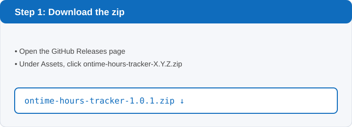
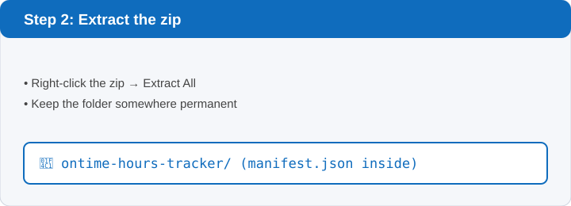
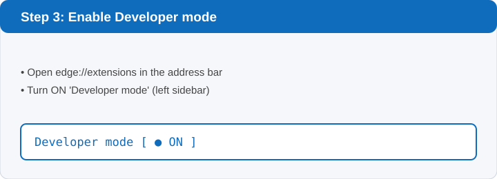
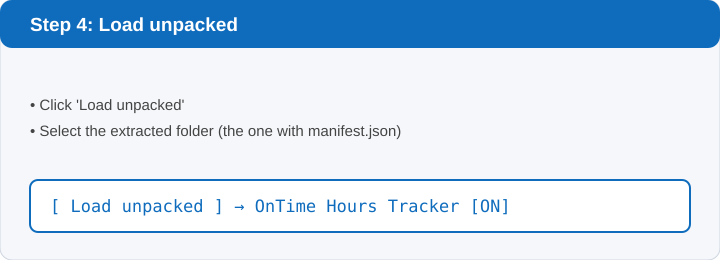

# OnTime Hours Tracker

Browser extension that shows working days and required / completed / pending hours on the Simform OnTime timesheet (`ontime.simformsolutions.com`).

## Download

**[Download the latest zip](../../releases/latest)** → under *Assets*, pick `ontime-hours-tracker-X.Y.Z.zip`.

## Install in Microsoft Edge (Developer mode)

The extension is not on the store, so it is loaded manually. Takes ~1 minute.

### 1. Download the zip
Open the [latest release](../../releases/latest) and click the `.zip` under **Assets**.

### 2. Extract it
Right-click the zip → **Extract All**. Put the folder somewhere permanent (Edge reads it from there every time it starts; don't delete or move it).

### 3. Enable Developer mode
Go to `edge://extensions` and switch **Developer mode** on (left sidebar).

### 4. Load the extension
Click **Load unpacked** and select the extracted folder (the one that directly contains `manifest.json`).

### 5. Use it
Open the OnTime timesheet; the hours panel appears. Pin the extension via the puzzle icon → pin for quick access to settings.

> The images above are simplified illustrations of each step, not exact screenshots; Edge's layout may differ slightly.

### Updating
Download the newer zip, extract it over the same folder (or to a new one), then on `edge://extensions` click **Reload** on the extension (or Remove → Load unpacked again).

### Troubleshooting
| Problem | Fix |
|---|---|
| "Manifest file is missing or unreadable" | You selected the wrong folder. Pick the one containing `manifest.json` directly. |
| "Disable developer mode extensions" popup on startup | Edge shows this for unpacked extensions; dismiss it / keep the extension enabled. |
| Panel doesn't show | Make sure you're on `https://ontime.simformsolutions.com/` and refresh the page. |

## Develop
Load `src/` unpacked. Release with `npm run release:patch|minor|major`; CI builds the zip and attaches it to a GitHub Release.
